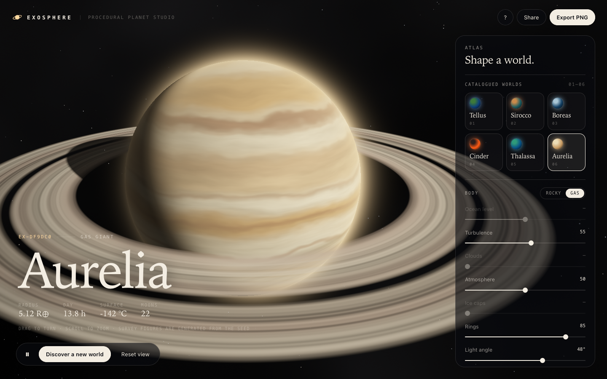
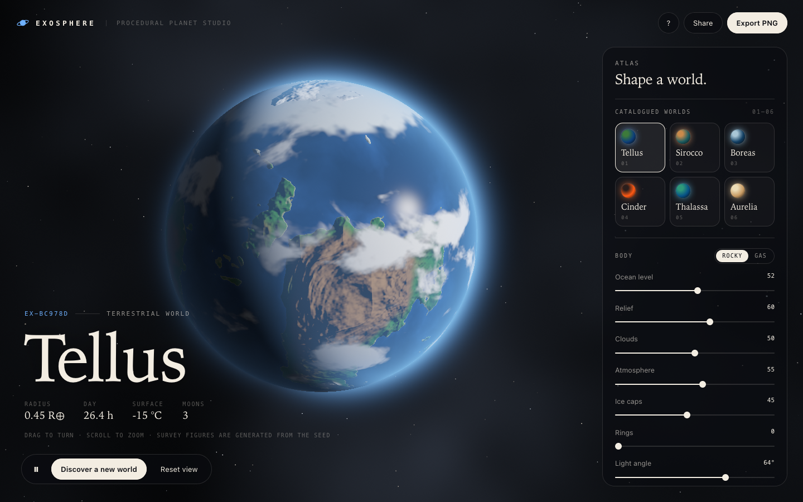
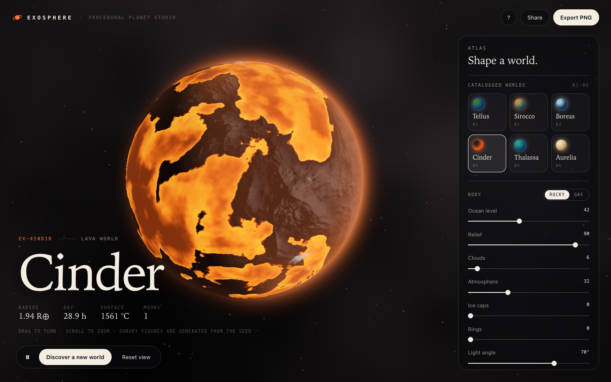
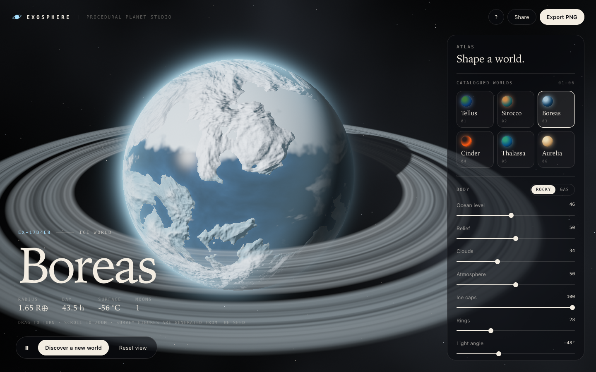
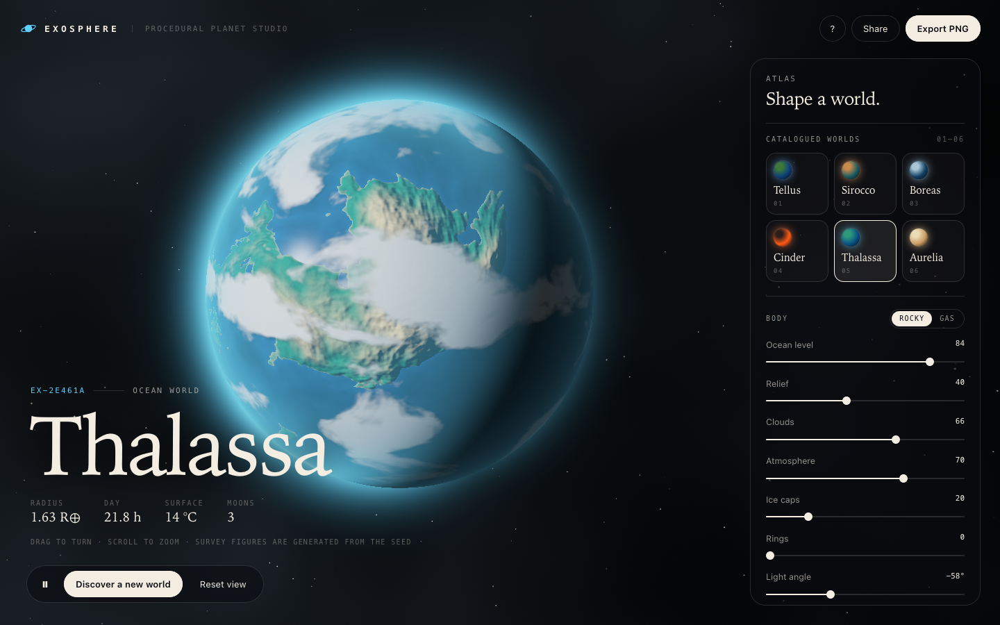

<div align="center">

# Exosphere

**A procedural planet studio where every world is drawn by a single GPU shader — an experiment built by an AI model.**

[**▶ Open the live demo**](https://videogameoutlaw.github.io/exosphere/)




</div>

> **This is a concept, not a product.** Exosphere was made by Claude Fable 5.2 in one sitting as an experiment: design something visually interesting, build it, test it and ship it end to end. The code, tests, screenshots and this README were produced by the model. It is published as-is and is not maintained.

## What it does

Exosphere renders planets that do not exist. There are no textures, meshes or image files: continents, oceans, cloud decks, polar ice, lava seas, gas bands, rings and the glow of the atmosphere are all computed per pixel, every frame, from a seed and a handful of numbers.

- **Six catalogued worlds** — a temperate world, a desert, an ice world with faint rings, a lava world, an ocean world and a ringed gas giant.
- **Discover** — one key generates a new planet with its own palette, climate, name and survey card.
- **Tune everything live** — ocean level, relief, clouds, atmosphere, ice caps, rings, light angle, spin and four colours.
- **Turn and zoom** — drag to rotate the body, scroll to move closer.
- **Share links** — the full world is encoded in the URL, so the same link always rebuilds the same planet.
- **PNG export** — save the current frame at canvas resolution.
- **Phone layout** — on narrow screens the controls collapse into a bottom sheet.

| Tellus | Cinder |
| --- | --- |
|  |  |
| **Boreas** | **Thalassa** |
|  |  |

## How a planet is drawn

Each pixel casts a ray at a unit sphere and solves the intersection analytically, so there is no ray marching and no geometry.

1. **Terrain** — domain-warped fractal noise gives a height at each point on the sphere; ridged noise and a fine detail layer add mountains and broken coastlines.
2. **Surface** — height against the ocean level decides water or land. Water is coloured by depth and gets a sun glint; land blends lowland to highland, with a bump-mapped normal taken from the height gradient.
3. **Ice** — latitude, altitude and noise decide where snow and sea ice form.
4. **Clouds** — a second, slowly drifting noise field is composited over the surface and also sampled toward the sun to cast shadows.
5. **Gas giants** — latitude bands are bent by turbulence, with a storm placed from the seed.
6. **Rings** — a ray-plane intersection with banded density. The planet shadows the rings and the rings shadow the planet.
7. **Atmosphere** — a rim term on the disc joins an exponential halo outside it, both lit by the sun.

The survey figures (radius, day length, temperature, moons) are invented from the seed for flavour. They are not physical simulation.

## Run it

Requires Node.js 20 or newer.

```bash
npm install
npm run dev
```

```bash
npm test              # settings, seeding, share links, discovery
npm run test:browser  # real rendering and interaction in Firefox
npm run build         # static site in dist/
```

The browser tests need a one-time `npx playwright install firefox`.

## Controls

| Input | Action |
| --- | --- |
| Drag | Turn the planet |
| Scroll | Zoom |
| `N` | Discover a new world |
| `1`–`6` | Load a catalogued world |
| `Space` | Pause or resume rotation |
| `R` | Reset the view |
| `H` | Hide the interface |
| `?` | About |

## Layout

```text
src/
├── shaders.js    # The planet: terrain, clouds, rings, atmosphere, stars
├── renderer.js   # WebGL2 setup, camera, uniforms
├── settings.js   # Presets, seeding, discovery, survey cards, share links
├── main.js       # Interface wiring and the frame loop
└── style.css     # Responsive interface
```

## Status

Experimental and unmaintained. It needs WebGL2 and a reasonably capable GPU, since the whole image is recomputed every frame. It was tested in Firefox on one machine (6 unit tests and 6 browser tests passing); other browsers and devices are untested. Fork it and take it further.
